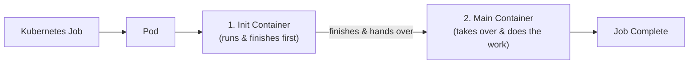

Hi all, in my previous blog titled - [OwnPreview #0: Why I’m Building a K8s Preview Platform](https://blog.darshanrander.com/posts/tech/ownpreview-0/), I talked about the why, what and how of the project and in this blog I will talk about the implementation and decisions made for building container images for the project.

## Building and Pushing the Container Image

The end goal is to build the container image and push it to a registry so we can pull the image and run it wherever we like.

There are multiple ways we could do this.

### Inside a Docker Container (Docker-in-Docker)

Pull a container with docker and run a build inside it. While this is what most of the people would think of first, there is a very big flaw in this approach. That is, **you cannot do it**! (not easily) Because in a container you don't have system access like you do on your machine or VM.

Remember, container is just a _process running on your system_ and it shares your kernel (it's a bit more complicated on Mac and Windows) and doesn't have the privileged access to all of your system.

This is a well-known issue and the Docker team had noticed it and built something to help you with it and presented it at [DockerCon 2023 - Docker-in-Docker: Containerized CI Workflows](https://youtu.be/JyEwKm-OfxA). This is a neat way to solve this issue, but you are again giving _privileged access_ to the DinD container which has a lot of security concerns.

### Go to the basics - BuildKit

[BuildKit](https://docs.docker.com/build/buildkit/) is the builder backend used by Docker and the best thing about it is that you get the benefits of DinD without the side-effects.

This also aligns with our approach where we want to deploy OwnPreview into a cluster.

## Building inside the cluster

Now that we have decided to use BuildKit, we can create a Job in the cluster which will clone the git repo and run buildkit.

> A Job in k8s will create one or more Pods to complete and execute a specified task



This is a simplified diagram of the project. We are using `initContainers` to clone the repo. Then BuildKit's image takes over to build and push the final image.

Init containers are perfect for such tasks; they do the groundwork for the main image to take over and complete the task.

```yaml
apiVersion: batch/v1
kind: Job
metadata:
  name: build-<app>-<version>
  namespace: <namespace>
spec:
  ttlSecondsAfterFinished: 3600
  template:
    spec:
      restartPolicy: Never
      initContainers:
        - name: git-clone
          image: alpine/git:latest
          command: ["sh", "-c"]
          args:
            - git init /workspace && cd /workspace && git remote add origin <git-url> && git fetch --depth=1 origin <git-ref> && git checkout FETCH_HEAD
          volumeMounts:
            - name: workspace-volume
              mountPath: /workspace
      containers:
        - name: buildkit
          image: moby/buildkit:master-rootless
          env:
            - name: BUILDKITD_FLAGS
              value: --oci-worker-no-process-sandbox
          command: ["buildctl-daemonless.sh"]
          args:
            - build
            - --frontend
            - dockerfile.v0
            - --local
            - context=/workspace
            - --local
            - dockerfile=/workspace
            - --output
            - type=image,name=<registry>/<image>:<version>,registry.insecure=false,push=true
          volumeMounts:
            - name: workspace-volume
              mountPath: /workspace
      volumes:
        - name: workspace-volume
          emptyDir: {}
```

The above Job yaml does this for you and pushes the image to the registry.

We define our **init container** (git-clone) to use the `alpine/git` image to pull the source code. It does a shallow clone (--depth 1) as we don't need full git history for the project. It will save a lot of time in bigger projects.

A **shared volume** (workspace-volume) helps to transfer clone seamlessly from `git-clone` to `buildkit`.

The main container uses `moby/buildkit:master-rootless` with (--oci-worker-no-process-sandbox) to build and push the image without root privileges.

Finally, once the Job is completed, k8s will automatically clean it up after an hour (ttlSecondsAfterFinished: 3600).

> I've omitted a few details like registry authentication secrets to keep the manifest readable. You can check out the full implementation in [image/builder.go](https://github.com/SirusCodes/ownpreview/blob/211c78449fec0226ad416e257b85cf32298283bf/image/builder.go)

## What I'm skipping in the prototype?

**Registry-based caching** - right now every Job starts with a fresh `emptyDir`, so every build runs from scratch. Storing intermediate layers in the registry lets future builds reuse them and cuts down build time.

## What's Next?

Next, I'll tackle the deployment and networking layer: deploying the built image onto the cluster and wiring up KEDA so preview environments scale from 0 to 1 on demand whenever a request hits them.

I'm Building in Public; you can view my progress and star the repo at [SirusCodes/ownpreview](https://github.com/SirusCodes/ownpreview).
